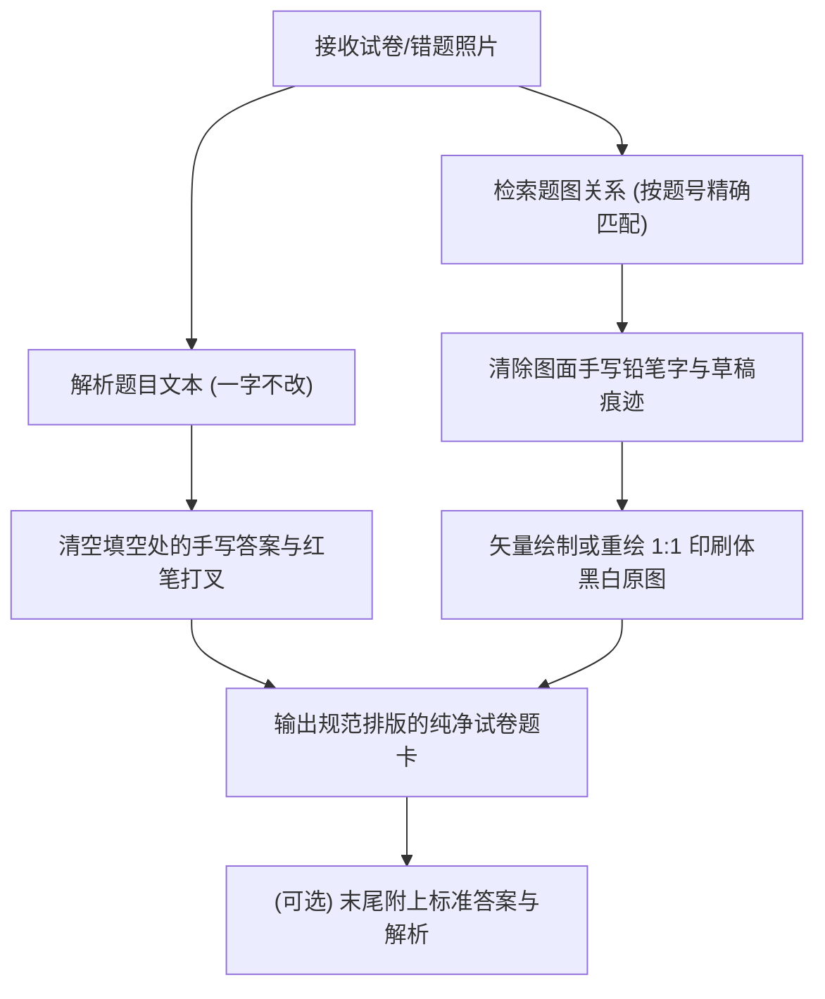

# 试卷原题还原与错题翻新规范 (Exam Paper Restoration)

本技能用于将学生写过、批改过或手机拍摄杂乱的试卷/练习册照片，**100% 还原为干净、空白、无任何笔迹的原版题目与标准印刷级配图**，便于制作错题本、重测练习卷或电子存档。

---

## 核心法则（六大铁律）

### 1. 文本一字不改 (Strict Literal Fidelity)
- **绝不篡改题干**：原题的所有文字（包括背景故事、生活百科标签、括号提示、计量单位、标点符号）必须**原样完整保留**。
- **严禁擅自“精简”**：不得将生活应用题强行抽象成纯数学模型题，不得擅自删去题目中的情境文字。

### 2. 准确理解“去干扰” (Physical vs Semantic Noise)
- 用户所说的“去干扰因素 / 整理题目”，**99% 的场景是指清除物理卷面上的干扰**：
  - ❌ **必须清除**：学生的笔算草稿、手写答案、红笔打圈打叉、橡皮擦黑斑、手机拍进来的相邻题目图文。
  - ✅ **必须保留**：原题本身所设定的各种已知条件（哪怕在数学解题角度属于冗余数据，也是原卷的一部分）。

### 3. 图形必须对应且原版纯净 (Pure & Paired Diagrams)
- **图题对应**：一张拍照中若包含多题插图（例如在第 10 题下方同时并排了第 10、11、12 题的图），必须**精准按图题编号拆分**，绝不能张冠李戴。
- **还原印刷版原貌**：
  - 几何图仅保留原试卷印制的内容（线框、顶点字母、原题已有的直角/角度标记）。
  - **严禁**把学生在图上涂写的铅笔尺寸、草稿数据留在图上。
  - **严禁**擅自在图上预先画出解题辅助线、阴影标注或答案提示（除非原题自带）。
  - 推荐输出高清晰度黑白线框图（SVG 转 PNG）。

### 4. 配图必须具备合适的比例与版面大小 (Appropriate Geometric & Display Scale)
新生成的几何配图必须严格遵守**几何保真比例**与**排版适度尺寸**：
- **几何比例保真 (Geometric Scale)**：
  - **角度与长短符合真实逻辑**：图形的线段长短与角度开度必须符合题设几何关系。例如 $\angle A = 45^\circ$ 时夹角必须真实接近等腰直角开度（不可画成 $30^\circ$ 或 $75^\circ$ 误导学生直觉）；若题设 $AE = 3BE$，视觉上 $AE$ 必须显著约为 $BE$ 的 3 倍；若 $AB = 10, CD = 4$，两边相对比例需大致约为 $2.5:1$。
- **版面显示尺寸适中 (Layout Sizing)**：
  - **严禁生成铺满全屏的超大巨图**：避免学生或家长看题时需要大幅上下翻页。
  - **严禁生成看不清字迹的微缩图**：顶点标签字母、直角符号必须一眼可辨。
  - **推荐标准画幅**：
    - 宽度建议控制在 **280px ～ 360px**（约占正文宽度的 40% ～ 50%）。
    - 高度建议控制在 **180px ～ 250px**。
    - 画布边距（Padding）：四周留白约 10% ～ 15%，避免文字或顶点贴边被裁切，也避免留白过多画面空洞。
    - 元素比例协调：线条粗细 2px 左右，顶点字号 16px ～ 20px，直角符号边长 14px ～ 16px。

### 5. 答案留空 (Blank Spaces)
- 原题中的所有填空括号 `(   )`，一律清空内部的笔迹与红叉，统一还原为整洁的标准空白括号，例如 `（ 　　　　 ）`。

### 6. 符号必须标准规范，严禁英文代称与代码化 (Standard Typographic Symbols)
中小学试卷有严格的印刷排版规范，数学符号严禁使用英文单词或编程语言符号代称：
- **四则运算符号**：
  - 必须使用标准算术符号：加号 `+`、减号 `-`（或标准减号 `−`）、乘号 `×`（LaTeX 中使用 `\times` 或 Unicode `×`）、除号 `÷`（LaTeX 中使用 `\div` 或 Unicode `÷`）。
  - **严禁**使用 `div`、`divide`、`times`、`mult` 等英文单词代称。
  - **严禁**使用编程符号（如用 `*` 代替乘号 `×`；除原卷本身印制为分式斜线外，不得随意用 `/` 代替除号 `÷`）。
- **几何与图形符号**：
  - 角度与度数：角必须使用 `∠`（LaTeX `\angle`），度数使用 `°`（LaTeX `^\circ`），严禁使用 `angle`、`deg`。
  - 几何关系：平行使用 `∥`（LaTeX `\parallel`），垂直使用 `⊥`（LaTeX `\perp`），三角形使用 `△`（LaTeX `\triangle`），相似使用 `∽`（LaTeX `\sim`），全等使用 `≌`（LaTeX `\cong`），严禁使用 `parallel`、`perp`、`triangle` 等英文词汇。
- **等号、近似与比较符号**：
  - 等号与约等：必须使用 `=`、`≈`（LaTeX `\approx`），严禁使用 `eq`、`approx`。
  - 大小比较：必须使用 `>`、`<`、`≥`（LaTeX `\ge`）、`≤`（LaTeX `\le`）、`≠`（LaTeX `\neq`），严禁使用 `geq`、`leq`、`neq`。
- **比号与单位**：
  - 比例号使用数学比号 `∶`（或 LaTeX `:`），严禁使用 `ratio` 或英文 `to`。
  - 单位必须使用教科书规范中文或标准国际单位（如 `厘米`、`分米`、`\text{cm}^2`、`\text{平方分米}`），不可胡乱拼接。

---

## 执行步骤流程

### 步骤一：提取原题正文
1. 逐字核对图片中的文字，保留题号（如 `3.`、`10.`、`12.`）。
2. 保留特殊标签（如 `【新情境】`、`【生活百科】`）。
3. 数学符号与公式规范（严禁英文代称与编程符号）：
   - 加减乘除严格统一为：`+`、`-`、`×`（LaTeX `\times`）、`÷`（LaTeX `\div`），严禁使用 `div`、`times`、`*` 等。
   - 几何与关系符号使用 `\angle`（`∠`）、`^\circ`（`°`）、`\parallel`（`∥`）、`\perp`（`⊥`）、`\approx`（`≈`）等标准符号，严禁使用 `angle`、`deg`、`parallel`、`approx` 等英文单词。
   - 示例：
     - 正确：$AB = 10\text{ 分米}$、$78 \times 90 = 7020$、$18 \div 3 = 6$、$\angle A = 45^\circ$、$AB \parallel CD$
     - 错误：`78 times 90`、`78 * 90`、`18 div 3`、`angle A = 45 deg`、`AB parallel CD`

### 步骤二：识别与清洗图形
1. 观察图下图注（例如 `（第 10 题）`），仅保留与当前题号匹配的图形。
2. 剔除图形内部/边缘的手写数字与涂鸦：
   - 比如学生在底边旁边写了数字，如果题干正文里才有这个数字，则说明是手写标注，应当抹去。
3. 保持与教科书一致的排版风格：
   - 线条：纯黑（#000000），线宽适中（1.5px - 2.5px）。
   - 顶点字母：斜体衬线体（Times New Roman 斜体）。
   - 图名：宋体居中（如 `（第 10 题）`）。

### 步骤三：格式化输出
1. 题干清晰展示。
2. 几何图紧随题干下方（使用 Markdown 图片语法直接渲染）。
3. 若用户需要答案，则在题目正文下方另起折叠区域或末尾附录呈现，不可混在空白原题中。

---

## 常用脚本工具

本技能内置了用于重绘几何配图的辅助脚本：
- [几何原图绘制脚本模板](./scripts/render_geometry.py)
- [防歧义意图指南](./references/intent-clarification.md)
- [真实错题还原对比示例](./examples/demo.md)
