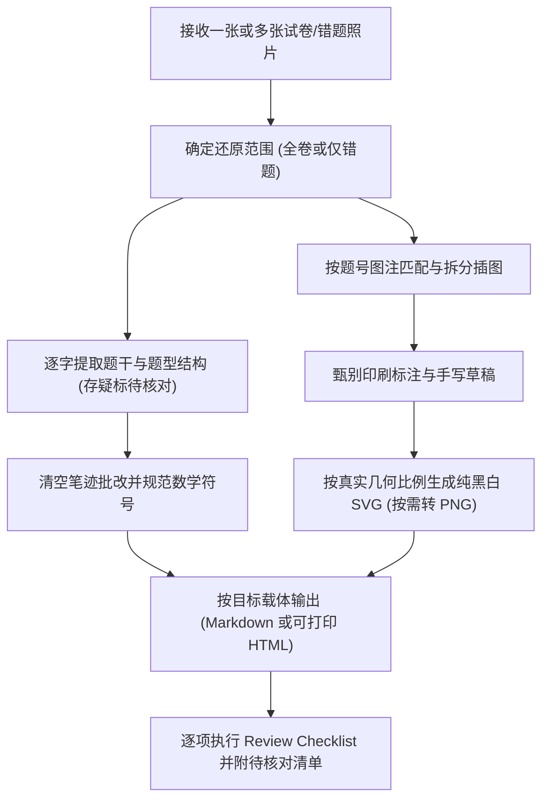

# 试卷原题还原与错题翻新规范 (Exam Paper Restoration)

本技能用于将学生写过、批改过或手机拍摄杂乱的试卷/练习册照片，**100% 还原为干净、空白、无任何笔迹的原版题目与标准印刷级配图**，便于制作错题本、重测练习卷或电子存档。

## 按需查阅参考 (Progressive Disclosure)

处理常规题直接遵循本文件流程；遇到以下场景时再加载对应参考，避免上下文冗余：

- 区分手写与印刷标注、模糊/遮挡占位规则、完整中小学数学符号对照表、用户提示词意图映射：阅读 [references/intent-clarification.md](references/intent-clarification.md)。
- 选择/判断/表格/分数与复合应用题排版、SVG 重绘边界（何时重绘 vs 保留原图裁剪）、可打印 A4 HTML 模板与配图命名约定：阅读 [references/question-types-and-output.md](references/question-types-and-output.md)。
- 真实还原前后对比样例：阅读 [examples/demo.md](examples/demo.md)。
- 将矢量 SVG 转为高清 PNG：使用 [scripts/render_geometry.py](scripts/render_geometry.py)。

---

## 核心铁律

### 1. 文本一字不改 (Strict Literal Fidelity)
- 完整保留原题所有文字：题号、栏目/情境标签（如 `【新情境】`、`【生活百科】`）、背景故事、括号提示、标点符号。
- 单位严格遵循原卷形态：原卷写中文单位（如 `平方分米`）就保留中文，写符号单位（如 `cm²`）就保留符号，不擅自换写。
- 绝不擅自“精简”情境文字或将应用题改写为纯算式。

### 2. 清除物理干扰，保留原题语义
- **必须清除**：学生手写答案、铅笔草稿、竖式演算、红笔打圈/打叉/批注、橡皮擦污渍、拍入画面的相邻无关题目图文。
- **必须保留**：原卷印制的全部已知条件（即便从解题角度属于冗余数据）。

### 3. 存疑不脑补 (No Silent Guessing)
- 遇到反光、折痕、红笔涂黑遮挡或拍照裁切导致**题干文字/数字无法辨认**时，严禁静默猜测补全。
- 在原文对应位置用 `[待核对：疑似XX]`（或 `[待核对：此处被遮挡/裁切]`）占位，并在最终输出末尾集中列出「待人工核对清单」。
- 无法确定图上某数字/角度是否为原卷印刷时，先保留并在核对清单中标明疑问。

### 4. 配图题号对应、原版纯净且比例真实
- **图题精准拆分**：一张图含多题并排插图（如第 10、11、12 题）时，按图注逐题拆分归位，杜绝张冠李戴。
- **纯净印刷风**：仅保留原卷印制的线框、顶点斜体字母、原题自带的直角/角度/阴影标记；彻底清除手写草稿数字，严禁擅自添画解题辅助线。
- **几何比例保真**：角度与线段长度严格按题设数值计算坐标（如 `∠A = 45°` 必须真实为 45°，`AE = 3BE` 必须严格为 3:1）。
- **版面尺寸适中**：宽度建议控制在 **280px ～ 400px**（约正文宽度 40% ～ 55%），**高度随图形真实几何比例自适应，不强行压扁或设死上限**；四周留白约 10% ～ 15%，线宽约 1.5px ～ 2.5px、顶点字号 16px ～ 20px，避免全屏巨图或模糊微缩图。
- **重绘边界**：平面几何、数轴、简易坐标系与统计图优先矢量 SVG 重绘；复杂实物照片/写实插图不强行重绘，按 [references/question-types-and-output.md](references/question-types-and-output.md) 标注原图裁剪提示。

### 5. 作答区统一留空
- 所有填空括号一律清空笔迹，统一使用纯文本全角空格 `（　　　　）`（判断题用 `（　）`），避免混用 `\qquad` 等依赖特定渲染器的写法；原卷为下划线填空则保留 `________`。
- 选择题保留全部原选项字母与内容，清空勾选与划痕。

### 6. 标准印刷数学符号
- 统一使用教科书标准符号：`+`、`-`、`×`、`÷`、`∶`、`∠`、`°`、`∥`、`⊥`、`△`、`≈`、`≥`、`≤`、`≠`。
- **Unicode 优先、按需 LaTeX**：普通四则运算、角度、比较与几何关系在纯 Markdown 中优先直接使用上述 Unicode 符号（避免不支持 LaTeX 的平台裸露 `\div` / `\times`）；上下分式（`\frac{a}{b}`）、方程组（`\begin{cases}...\end{cases}`）、循环小数点（`0.\dot{3}`）在支持 LaTeX 的 Markdown 中用 `$...$`，在可打印 A4 HTML 中使用纯 CSS 分式样式（见 [references/question-types-and-output.md](references/question-types-and-output.md)）。
- 严禁输出 `div`、`times`、`angle`、`deg`、`parallel`、`approx` 等英文宏名/缩写，以及 `*`、`/`（原卷本身印制斜杠分式除外）等编程符号。完整对照表见 [references/intent-clarification.md](references/intent-clarification.md)。

---

## 执行流程

### 步骤一：确定范围与跨图归并
1. 默认还原照片中所有完整题目，按原卷题号顺序排列。
2. 若用户指定“只整理错题 / 只提取打叉的题”，按红叉、红圈、扣分或订正痕迹筛选题目；还原成品中依然彻底清除这些批改痕迹。
3. 一次上传多张照片时，自动合并跨图分离的同一道题（如题干在图 1、配图在图 2）。

### 步骤二：提取文本与清洗配图
1. 按原卷题型还原文本、选项、表格与算式（各题型细则见 [references/question-types-and-output.md](references/question-types-and-output.md)）。
2. 结合笔迹、字体、颜色、基线位置判断图上标注归属：仅删除确认为手写/批改的痕迹，无法确认时保留并登记到待核对清单。
3. 几何配图采用纯黑线条（`#000000`）、纯白背景（`#ffffff`）、顶点斜体衬线字体（`Times New Roman` 斜体）、居中宋体图注（如 `（第 10 题）`）。
4. 生成 `.svg` 后可用 `python3 <skill-dir>/scripts/render_geometry.py --check-only q10.svg` 校验白底、纯黑白配色、尺寸与文本边界；Markdown / HTML 场景优先直接使用矢量 `.svg`，需贴入 Word、微信或不支持 SVG 的工具时，调用 `python3 <skill-dir>/scripts/render_geometry.py q10.svg q10.png --scale 2`（多图可用 `--output-dir out/ q10.svg q12.svg` 批量导出高清 PNG）。

### 步骤三：格式化交付
1. **默认交付（对话预览 / `.md` 文件）**：题干 + 紧随其后的配图；若用户需要参考答案与解析，另起折叠区或放在文末附录，严禁混入空白原题。
2. **打印重做交付（用户要求“打印版 / A4 错题卷 / HTML”）**：按 [references/question-types-and-output.md](references/question-types-and-output.md) 生成自包含可打印 HTML。
3. 若存在模糊、遮挡或图注存疑项，在末尾附加「待人工核对清单」；无存疑则省略该节。

---

## 完成自检清单 (Review Checklist)

输出前逐项核对，缺一不可：

- [ ] **逐字保真**：背景故事、情境标签、单位形态、标点、小问编号均与原卷一致，无擅自删改。
- [ ] **物理净空**：所有填空、选择、判断、表格填写格及图形均已清空手写答案、草稿与红笔批改痕迹。
- [ ] **无静默脑补**：模糊/遮挡/裁切处均已显式标记 `[待核对：...]`，并在文末汇总。
- [ ] **符号合规**：全文无 `div`、`times`、`*`、`angle`、`deg`、`parallel`、`approx` 等英文/代码符号残留。
- [ ] **图题匹配与比例**：每张图严格对应题号，几何角度与线段比例经坐标核算吻合题设，无解题辅助线，尺寸与留白协调。
- [ ] **答案隔离**：未把答案或解析混入空白题干中。
