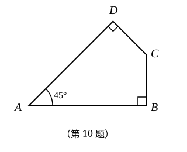
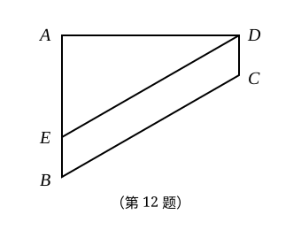

# 真实试卷错题翻新示例 (Demonstration)

本样例记录了从“带手写涂改的实拍图片”到“纯净印刷版原题与配图”的标准交付过程。

---

## 样例一：生活情境题（去卷面草稿与红叉，保留情境）

### 原始照片状况
- 包含【新情境】【生活百科】标题。
- 题号被红笔圈出。
- 填空处写了错误答案“3510”，并被红笔打了个大红叉。
- 题干右侧有竖式演算草稿：`78×90=7020`、`7020×50=351000`。

### 规范还原交付

**3.【新情境】【生活百科】** 我国交通标志尺寸执行国家标准，如三角形标志边长常见的有 70 厘米、90 厘米和 110 厘米。如果要制作 50 块边长为 90 厘米的三角形交通标志，每块高约 78 厘米，制作这些交通标志一共约需要（　　　　）平方分米的铁皮。

*注：原卷本题无配图，填空处已清空。*

---

## 样例二：几何四边形（拆分排版并清除图上手写数字）

### 原始照片状况
- 照片下方并排拍摄了“第10题”、“第11题”、“第12题”三个插图。
- 第10题图上的底边 $AB$ 旁手写了铅笔“10”，$CD$ 旁手写了“4”。

### 规范还原交付

**10.** 如图，$AB = 10\text{ 分米}$，$CD = 4\text{ 分米}$，$\angle A = 45^\circ$，$\angle B$ 和 $\angle D$ 都是直角。那么四边形 $ABCD$ 的面积是（　　　　）平方分米。

*(图注：已剔除下方并排的第11、12题插图，去除了底边及腰上的铅笔手写数字)*

---

## 样例三：直角梯形与平行四边形（图文准确对应并去手写草稿）

### 原始照片状况
- 题目照片中填空写了“6”并被打红叉。
- 对应插图在另一张照片中，且图上画了大括号“3”，$BC$ 下写了“18”。

### 规范还原交付

**12.** 如图，直角梯形 $ABCD$ 中，$AE$ 的长度是 $BE$ 长度的 3 倍，平行四边形 $BCDE$ 的面积是 $18\text{ 平方厘米}$，那么三角形 $AED$ 的面积是（　　　　）平方厘米。

*(图注：已准确匹配第12题对应插图，去除了手写大括号“3”与草稿数字“18”)*

---

## 样例四：四则运算与算式题（规范标准算术符号，严禁英文与代码代称）

### 原始照片状况
- 包含括号、乘除法的脱式计算题。
- 学生草稿写了 `24*5`、`120/4`，填空处被批改打叉。

### 规范还原交付

**5.** 脱式计算，能简算的要简算：
(1) $360 \div (18 \times 2) + 45$
(2) $4.8 \times 10.1 - 4.8 \div 10$

*(注：所有运算符号统一使用中小学教科书标准符号 $+ - \times \div$，严格杜绝 `div`、`divide`、`times`、`*`、`/` 等英文或编程代码代称)*
